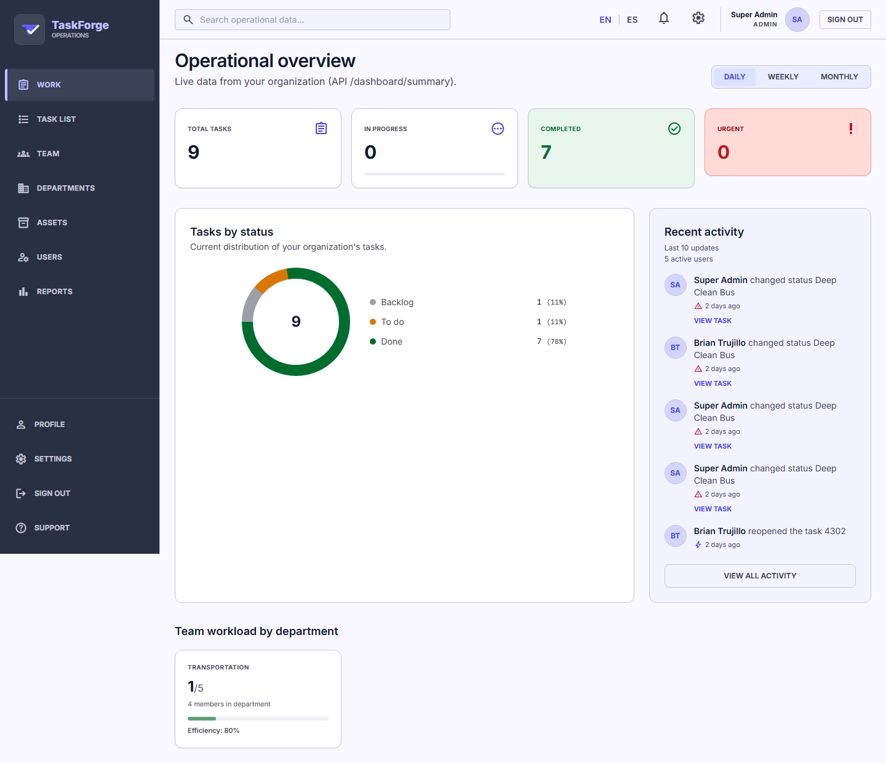
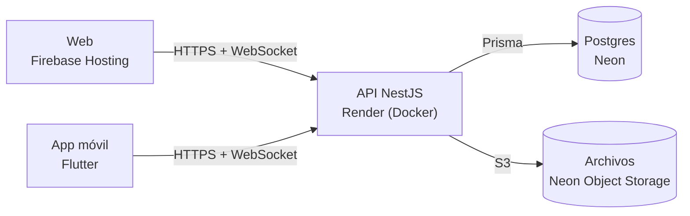

# Task Forge

App de gestión de tareas y activos para equipos: una API, una web y una app móvil que comparten los mismos datos. Está online desde el 2026-11-26, toda en planes gratuitos (costo $0).



**Funciones:** tareas y subtareas (lista y kanban) con adjuntos, panel y reportes, equipos y departamentos, catálogo de activos, usuarios con roles y permisos, notificaciones en tiempo real y organizaciones con su propio logo. Hay más capturas en [TaskForge/](TaskForge/).

> El repositorio es **público**. Nunca subas contraseñas, claves ni archivos `.env.*`.

## Dónde verlo

| Qué | Dónde |
| --- | --- |
| Web (la app) | https://taskforge-ops.web.app |
| API | https://taskforge-api-rolx.onrender.com |
| Documentación de la API (Swagger) | https://taskforge-api-rolx.onrender.com/docs |
| Base de datos y archivos | [console.neon.tech](https://console.neon.tech), proyecto `taskforge` |
| Panel de la API | [dashboard.render.com](https://dashboard.render.com), servicio `taskforge-api` |
| Panel de la web | [Consola de Firebase](https://console.firebase.google.com/project/taskforge-ops/overview), Hosting |

El registro público de usuarios está desactivado. Las credenciales del administrador las tiene el responsable del proyecto; no están en el repo.

## Tecnologías

| Parte | Carpeta | Tecnologías |
| --- | --- | --- |
| API | [backend/](backend/) | NestJS 11, Prisma 6, PostgreSQL, Socket.IO (namespace `/events`), JWT de acceso y refresh, Swagger, AWS SDK S3 |
| Web | [web/](web/) | React 19, Vite 6 |
| Móvil | [mobile/](mobile/) | Flutter, GetX, Dio, socket_io_client |

## Cómo está montado online



| Pieza | Servicio | Detalle |
| --- | --- | --- |
| Base de datos | Neon Postgres 17, AWS us-east-2 (Ohio) | La API usa la URL *pooled* (host con `-pooler`); migraciones y restauraciones usan la URL directa. |
| Archivos (adjuntos, logos) | Neon Object Storage, bucket privado `taskforge-uploads` | La API los lee del bucket y los sirve en `/uploads/...`; el bucket nunca se expone. |
| API | Render, plan free, región Ohio | Se construye con [backend/Dockerfile](backend/Dockerfile) según [render.yaml](render.yaml). Health check en `/health`. |
| Web | Firebase Hosting (plan Spark), proyecto `taskforge-ops` | Publica `web/dist` según [firebase.json](firebase.json). |

## Correr en local

Requisitos: Node 22, Docker y Flutter (solo para la app móvil).

```bash
# 1. Base de datos (Postgres 16 en el puerto 5433)
docker compose up -d postgres

# 2. API en http://localhost:3000
cd backend
cp .env.example .env
npm install
npx prisma migrate deploy
npm run prisma:seed
npm run start:dev

# 3. Web en http://localhost:5173 (redirige /api a la API local)
cd web
npm install
npm run dev

# 4. Móvil (en el emulador de Android la API local es 10.0.2.2:3000)
cd mobile
flutter run
```

Para que la app móvil use la API online:

```bash
flutter run --dart-define=API_BASE=https://taskforge-api-rolx.onrender.com
```

## Desplegar

Lo que está online sale de la rama `deploy-online`.

**API (Render):** el auto-deploy está apagado. Después de hacer push, ve a Render, `taskforge-api` → *Manual Deploy*. El contenedor **no** aplica migraciones: si cambia el esquema de Prisma, antes de desplegar corre `npx prisma migrate deploy` desde `backend/`, con `DATABASE_URL` apuntando a la URL **directa** de Neon (sin `-pooler`).

**Web (Firebase):**

```bash
cd web
VITE_API_URL=https://taskforge-api-rolx.onrender.com npm run build
cd ..
firebase deploy --only hosting --project taskforge-ops
```

### Variables de entorno de la API

Se configuran en Render; los nombres están en [backend/.env.example](backend/.env.example).

| Variable | Valor online |
| --- | --- |
| `DATABASE_URL` | URL *pooled* de Neon (secreta) |
| `JWT_ACCESS_SECRET`, `JWT_REFRESH_SECRET` | Generadas por Render (secretas) |
| `CORS_ORIGIN` | `https://taskforge-ops.web.app` |
| `PUBLIC_SIGNUP` | `false` (bloquea registro y creación de organizaciones) |
| `STORAGE_DRIVER` | `s3` (en local, `local`, que guarda en `backend/uploads/`) |
| `S3_ENDPOINT`, `S3_ACCESS_KEY_ID`, `S3_SECRET_ACCESS_KEY` | Datos del bucket de Neon (secretos) |
| `S3_REGION`, `S3_BUCKET` | `us-east-2`, `taskforge-uploads` |

### Scripts útiles

- [backend/scripts/set-user-password.js](backend/scripts/set-user-password.js): cambia la contraseña de un usuario y cierra sus sesiones. Usa `DATABASE_URL`, `USER_EMAIL`, `NEW_PASSWORD` (mínimo 12 caracteres) y `ORG_SLUG` (por defecto, `default`).
- [backend/scripts/upload-files-to-s3.js](backend/scripts/upload-files-to-s3.js): sube `backend/uploads/` al bucket y verifica cada archivo.

## Límites del plan gratis

- **Render duerme la API** tras 15 minutos sin uso. La primera petición después tarda alrededor de 1 minuto; por eso la app móvil espera hasta 75 s.
- **El disco de Render no persiste.** Por eso los archivos van al bucket y no al disco.
- **Neon y Firebase** tienen cuotas gratis de almacenamiento y tráfico, de sobra para un equipo pequeño.

## Pendientes

- **Quitar "-ops" de la dirección web.** `taskforge-ops.web.app` no se puede renombrar, porque sale del ID del proyecto. Hay dos salidas gratis:
  - Crear otro sitio en el mismo proyecto, por ejemplo `taskforge.web.app` (no sabremos si el nombre está libre hasta intentarlo). Después hay que actualizar `CORS_ORIGIN` en Render.
  - Conectar un dominio propio (el dominio cuesta unos $10–15 al año).
- **Compilar un APK** que apunte a la API online.
- **Unir `deploy-online` a `main`.**
